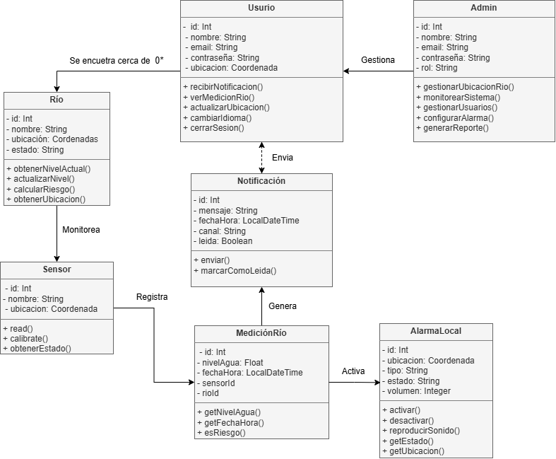

#  RiverAlert - Sistema de Monitoreo y Alerta Temprana de Crecidas

RioAlert es una aplicación móvil Android, desarrollada en Java, que permite visualizar en tiempo real el nivel de los ríos y alertar a la población ante el riesgo de crecidas. El sistema combina sensores de nivel conectados a un microcontrolador ESP32, una base de datos en la nube y notificaciones dirigidas a los usuarios que se encuentran cerca de un río en situación de riesgo.

##  Descripción General

Las crecidas de ríos representan un riesgo importante para las comunidades cercanas a los cauces. RioAlert busca reducir ese riesgo mediante la detección temprana de aumentos en el nivel del agua y la notificación inmediata a las personas potencialmente afectadas.

El sistema se compone de tres capas:

- **Capa de campo (IoT):** sensores ultrasónicos conectados a un ESP32 que miden el nivel del agua.
- **Capa de nube:** Firebase Realtime Database, que almacena y distribuye las mediciones en tiempo real.
- **Capa de usuario:** aplicación Android que muestra el estado de los ríos, recibe notificaciones y permite la administración del sistema.

---

##  Objetivos

- Monitorear de forma continua el nivel de agua de uno o varios ríos.
- Calcular el riesgo de crecida a partir de las mediciones registradas.
- Notificar a los usuarios cercanos a un río cuando se detecte una situación de riesgo.
- Activar alarmas locales en el lugar de instalación del sensor.
- Brindar a los administradores herramientas de gestión, monitoreo y generación de reportes.

---
## Modelo de Clases

El siguiente diagrama describe las entidades principales del sistema y las relaciones entre ellas.

---
##  Funcionalidades Principales

**Para el usuario**
- Visualización en tiempo real de las mediciones de los ríos.
- Recepción de notificaciones de alerta según su ubicación.
- Actualización de ubicación y cambio de idioma.
- Inicio y cierre de sesión.

**Para el administrador**
- Gestión de usuarios y de la ubicación de los ríos.
- Monitoreo del estado general del sistema.
- Configuración de alarmas.
- Generación de reportes.

**Para el sistema**
- Registro automático de mediciones enviadas por los sensores.
- Evaluación de riesgo en cada medición.
- Generación y envío de notificaciones.
- Activación de alarmas locales (sonido con volumen configurable).